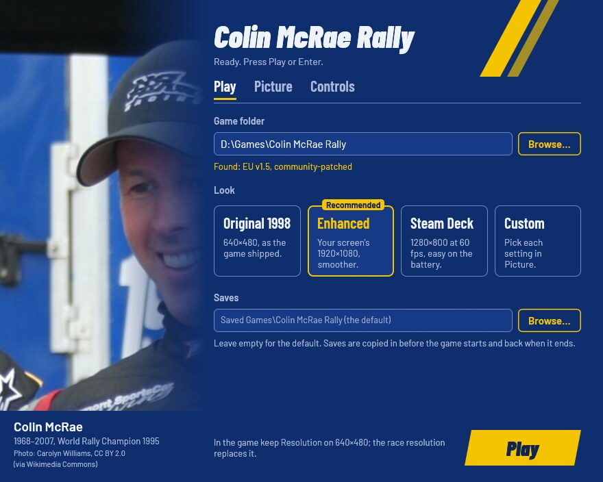

# Colin McRae Rally Launcher

Play your own copy of the 1998 PC game **Colin McRae Rally** on Windows
10/11, the Steam Deck and Linux (Proton, Wine or the AppImage). Point the
launcher at your installed game and press **Play**. Everything the game
needs is bundled and set up for you, so you don't need mods, patchers,
compatibility settings or registry edits. Your game folder is only read,
never changed: the launcher plays from a private copy.

This project contains no game files: you need your own copy of the game.

> **Work in progress.** It has been played end to end under Linux, with
> Wine and with Proton. It hasn't been tried on native Windows or on a
> Steam Deck yet. If you play on either, please
> [send a test report](https://github.com/akitaonrails/rea-colin-mcrae/issues/new?template=test-report.yml).

[](https://new-uploads-akitaonrails.s3.us-east-2.amazonaws.com/2026/11/01/colin-mcrae-rally/showcase-h264.mp4)

*Greece and Sweden in 16:9 widescreen at high resolution with the HD art
pack: the redrawn HUD, pace-note signs, skies and distant scenery. Click to
watch (3 minutes, with sound).*

## Problems this launcher solves

| Problem | What the launcher does |
| --- | --- |
| The game won't start on a modern PC: it stops at its CD check, its Windows version check and its old graphics modes. | It starts on today's Windows and under Wine and Proton, from the installed files, with no CD. |
| Under Wine it falls back to slow software drawing on some PCs, or uses the weaker of two graphics cards. | It runs on your graphics card, the faster one on PCs with two. The game's slowest drawing step is fixed: races held 60 fps at 4K on the test PC. |
| Closing the game window (or Alt+F4) does nothing. | Closing the window quits the game. |
| Only the left stick drives; triggers do nothing. | The triggers or the right stick are the throttle and brake. With an Xbox-style pad both triggers work at once (left-foot braking). Start pauses a race and the d-pad moves through the menus. |
| The 1998 button order feels wrong on today's pads. | A modern layout by default (A handbrake, bumpers change gear, Y changes the view), or the 1998 order, or your own. |
| The controller choice falls back to the keyboard by itself, and some saves leave the car turning in circles. | The choice stays, and a save left in that state starts normally again. |
| No rumble. | Optional rumble on impacts, with a test button in the window. |
| The game offers no race resolution above 800×600, and stretches on a wide screen. | Races at higher resolutions, up to 4K. 16:9 widescreen shows more to the sides instead of stretching, and the HUD, messages, results and loading screens scale with the resolution. |
| The view ends close, and scenery pops in between stage sections. | A longer view, up to 3× further, eased when the stage changes it, with less flicker on distant hills. |
| Textures shimmer in the distance. | Smooth textures that don't shimmer, or a crisp unfiltered look. A frame-rate cap and a vsync choice for even frames. |
| The art is 640×480. | The HD art pack, bundled: the race HUD, the intro, menus, loading screens, logos, skies, banners, billboards and the cars' liveries, redrawn at high resolution. |
| Patching the game folder risks your copy. | Your game folder is only read; the launcher plays from its own copy and keeps your saves in a folder of their own. |

## Screenshots



## What you need

**Colin McRae Rally for Windows PC, the original 1998 CD-ROM release by
Codemasters, installed and updated to version 1.5.**

- Install it from your CD with the **full install** option: the launcher
  can't read data that was left on the CD.
- Apply the official Codemasters **v1.5 update** if your copy isn't updated
  yet. The installed folder holds `Rally.exe` next to the folders `Game`,
  `New_Fe` and `ini`.
- An installed copy from an older PC, or a backup of the game folder,
  works too: the launcher only needs that folder.

Recognised today: the official European v1.5 `Rally.exe`, and the European
v1.5 `Rally.exe` from a community fan pack. The launcher checks your
`Rally.exe`. If it doesn't know your version, it says so, shows a code
(its SHA-256) and does not start the game. Please report that code with
the [unknown version form](https://github.com/akitaonrails/rea-colin-mcrae/issues/new?template=unknown-edition.yml).
Report the code, never the executable.

Not supported: the PlayStation version, *Colin McRae Rally 2.0* and later
games.

## Download and install

Download from the [latest release](https://github.com/akitaonrails/rea-colin-mcrae/releases/latest):
`CMRLauncher-<version>.zip` for Windows, Steam and your own Wine, or
`CMRLauncher-<version>-x86_64.AppImage` for Linux without Steam.

### Windows

1. Unpack the zip anywhere, for example into your game folder.
2. Keep `CMRLauncher.exe`, `cmrhooks.dll` and the `hd` folder together:
   `cmrhooks.dll` draws the HUD at high resolutions and `hd` is the HD art
   pack.
3. Double-click `CMRLauncher.exe`. The settings window opens.

The launcher isn't signed, so the first start from a downloaded zip may
show "Windows protected your PC": click **More info → Run anyway**.

On native Windows 10 the launcher itself (the window, wrong folders, the
command line) has been tested, the game not yet. Whether it works or not, please
[send a test report](https://github.com/akitaonrails/rea-colin-mcrae/issues/new?template=test-report.yml)
with your `launcher.log` (see [Where things live](#where-things-live)).

### Steam Deck

Not tested on a Deck yet. In Desktop Mode:

1. Unpack the zip, for example into `~/Games/cmr-launcher`.
2. In Steam: **Games → Add a Non-Steam Game to My Library… → Browse**, and
   pick `CMRLauncher.exe`.
3. Right-click it → **Properties → Compatibility** → tick **Force the use
   of a specific Steam Play compatibility tool** and choose **GE-Proton**
   (installed with ProtonUp-Qt from Discover).

Back in Game Mode, the window offers the **Steam Deck** look and works
with the Deck's controls (see [The settings window](#the-settings-window)).
Under Proton, Steam shows the Deck's controls to the game as an
Xbox-style pad, so rumble should work.

### Linux: AppImage

```sh
chmod +x CMRLauncher-*-x86_64.AppImage
./CMRLauncher-*-x86_64.AppImage
```

It brings its own Wine, so nothing else has to be installed. Its Wine
prefix is `~/.local/share/cmr-launcher/prefix`. If
[gamescope](https://github.com/ValveSoftware/gamescope) is installed, the
game runs in it at the right size (recommended, especially with a rotated
monitor); otherwise in a plain window. Your Linux files are drive `Z:` in
the window.

### Linux: Steam (Proton)

The same steps as for the Steam Deck, with the zip's `CMRLauncher.exe`
(tested with GE-Proton 11; Proton Experimental should work too). Proton
runs the launcher directly, without the Linux helper or gamescope.

### Linux: your own Wine

The zip's `linux/cmr-play` runs the game through your Wine and gamescope:

```sh
linux/cmr-play           # the settings window, then the game
linux/cmr-play --play    # the game with the saved settings, no window
linux/cmr-play stop      # end the game
linux/cmr-play status    # running or idle
```

Variables, a distrobox and the session are in
[linux/README.md](linux/README.md).

## First run

1. Press **Browse…** and pick the folder with your `Rally.exe`. Under Wine
   your Linux files are drive `Z:`, e.g. `Z:\home\you\Games\Colin McRae Rally`.
   The window shows which version it found.
2. Pick a look. The first run starts on **Steam Deck**; **Enhanced** fits
   your screen and is marked Recommended (on a Deck, Steam Deck is).
3. Press **Play** (or Enter, or Start on a pad).

The first start takes a few seconds while the launcher copies the game into
its private folder and installs the HD art pack there; later starts copy
only what changed. Your choices are remembered for next time.

## The settings window

- **Play**: the game folder, the look and the saves folder.
- **Picture**: each picture setting (and on Linux the scaler).
- **Controls**: rumble with a **Test** button, then the pad layout:
  **Modern**, **Original 1998** or **Custom**, with a button for each
  action.

| Look | Race resolution | Picture | When to pick it |
| --- | --- | --- | --- |
| **Original 1998** | the game's own (640×480) | the game as it shipped; only the left stick drives (no trigger pedals) | to play it as in 1998 |
| **Enhanced** | your screen's | widescreen on wide screens, 1.5× draw distance, smooth textures, eased view distance, vsync, HD art | on a PC (Recommended) |
| **Steam Deck** | 1280×800 | widescreen, 1.25× draw distance, smooth textures, eased view distance, vsync, 60 fps cap, HD art | on a Deck, easy on the battery; the first run's look |
| **Custom** | any | any change in the Picture tab | your own mix |

The pad's trigger pedals come with the look: on in Enhanced and Steam
Deck, off in Original 1998. Closing the game window quits the game in
every look.

The window works with a pad or the keyboard alone: the d-pad or Tab moves
between controls, A or Space changes the one in focus, LB/RB or Ctrl+Tab
switch tabs, and Start or Enter plays. **Play** stays greyed out
until the game folder holds a version the launcher knows, and the line
next to it says why.

## Gamepad

In the game: **Options → Settings → Controller 1**, set **Control method**
to your pad (Joystick 1) and **Controller type** to **Analogue joystick**,
then set steering, acceleration and braking to **Analogue** on the next
screen.

| On the pad | In menus | In a race |
| --- | --- | --- |
| A | select | handbrake |
| B | back | — |
| Y | — | change view |
| LB / RB | — | gear down / up |
| Triggers or right stick | — | brake / throttle |
| Start | — | pause |
| D-pad | move | — |

That is the **Modern** layout; pick another in the **Controls** tab.
Rumble and separate trigger pedals need an Xbox-style (XInput) pad; on
8BitDo pads use X-input mode. Under Wine and Proton, **Run joystick panel**
in the game does nothing (it opens an old Windows dialog that can't appear
there). To see what your pad sends to the game, run
`CMRLauncher.exe --controllers` and move every stick and button; the
result goes to `launcher.log`.

## Options

Every option has the same name in the window, in `launcher.cfg`
(underscores) and as a flag (hyphens). `launcher.cfg` is in
[Where things live](#where-things-live); the first run writes it with
every option commented out and explained.

| `launcher.cfg` / flag | In the window | Values | Unset | What it changes |
| --- | --- | --- | --- | --- |
| `game` / `--game` | Play: Game folder | a folder | found next to the launcher, else asked | The folder with your installed `Rally.exe`; only read. Remembered once given. |
| `saves` / `--saves` | Play: Saves | a folder | `Saved Games\Colin McRae Rally` | Where your saves and settings (`cmRally.cfg`, `SAVESLOT*.cms`) are kept: copied into the game before it starts and back when it ends. |
| `runtime` / `--runtime` | — (file and flag only) | a folder | `%LOCALAPPDATA%\CMRLauncher\Rally` | Where the launcher keeps its private copy of the game. |
| `language` / `--language` | — (advanced) | `ENGLISH`, `FRENCH`, `GERMAN`, `SPANISH`, `ITALIAN` | English | The `Language` value seeded into the game's registry key when it is missing. The game picks and keeps its own language; changing this later changes nothing ([docs/RUNTIME_NOTES.md](docs/RUNTIME_NOTES.md)). |
| `look` / `--look` | Play: the look cards | `original`, `enhanced`, `steam_deck` | each picture option on its own | Every picture setting at once; picture options given on their own win over it. The window saves the single values instead. |
| `resolution` / `--resolution` | Picture: Race resolution | `WIDTHxHEIGHT` (320×240 to 7680×4320), `original`, `off` | the game's own | The size races are drawn at, in place of the game's 640×480. Keep the game's own Resolution option on 640×480; the menus stay 640×480. |
| `widescreen` / `--widescreen` | Picture: Widescreen | `on`, `off` | off | On a 16:9 or wider race resolution, shows more to the sides instead of stretching. |
| `draw_distance` / `--draw-distance` | Picture: Draw distance | `1.0` to `3.0` | the game's own | How far you see. Longer costs speed and can flicker far away. |
| `texture_filter` / `--texture-filter` | Picture: Textures | `original`, `smooth`, `sharp` | the game's own | Smooth: no shimmering in the distance. Sharp: crisp, unfiltered pixels. |
| `fps_limit` / `--fps-limit` | Picture: Frame-rate cap | `10` to `1000`, `off` | no cap | The most frames a second the picture is redrawn; the driving keeps its own rate. |
| `vsync` / `--vsync` | Picture: Vsync | `on`, `off` | the game's own | Waits for the screen's refresh: no tearing. |
| `smooth_distance` / `--smooth-distance` | Picture: Ease view distance | `on`, `off` | off | Eases the stage's view distance changes over about a second, so scenery doesn't pop in. |
| `hd_art` / `--hd-art` | Picture: HD art | `on`, `off`, or a folder made with `cmr-hd` | off | The HUD, logos, menu pictures and more, redrawn at high resolution ([docs/UPSCALING.md](docs/UPSCALING.md)). |
| `scaler` / `--scaler` | Picture: Scaler (Linux only) | `nearest`, `pixel`, `fsr`, `linear` | `linear` | How gamescope enlarges the picture: Crisp pixels, Even pixels, FSR or Soft. Read by `cmr-play`. |
| `gamepad_axes` / `--gamepad-axes` | — (advanced; the look sets it) | `on`, `off` | on (off in the Original look) | Triggers or right stick as throttle and brake, Start pauses. Off: only the left stick drives, as in 1998. |
| `rumble` / `--rumble` | Controls: Rumble | `0` to `100`, `off` | off | Shakes the pad on impacts, at this strength in percent. |
| `buttons` / `--buttons` | Buttons: Pad buttons | `modern`, `original`, or eight button numbers | `modern` | The pad layout. The numbers are for select, back, change view, gear down, handbrake, gear up, (unused), pause, e.g. `1,2,4,5,1,6,7,8`. |
| `close_quits` / `--close-quits` | — (advanced) | `on`, `off` | on, in every look | Closing the game window (Alt+F4) quits the game. Off: the 1998 behaviour. |

Unset means the game's own value (or the default named above). Starting
`CMRLauncher.exe` with any option skips the window and plays; options
override `launcher.cfg` for that run, and only `--game` is remembered.
For example, in Steam's launch options:

```text
CMRLauncher.exe --look enhanced --draw-distance 2
CMRLauncher.exe --resolution original
CMRLauncher.exe --check --game "D:\Games\Colin McRae Rally"
```

The launcher's own switches:

- `--no-window`: play with the saved settings, no window.
- `--settings [--linux]`: only the window, for `cmr-play` (exit 0 Play
  pressed, 3 closed without Play, 4 no window possible, 5 another
  launcher is running; `--linux` adds the scaler).
- `--check`: checks the game folder and its `Rally.exe` without playing.
  The report goes to the terminal and `launcher.log`; exit 0 ready, 1 not,
  5 another launcher is running.
- `--controllers [seconds]`: logs what your joysticks send to
  `launcher.log`.
- `--help`: the list of options.

A flag or value the launcher can't use exits with 2 and prints what it
needs and the options; started without a terminal, it shows a short
message instead. Only one launcher runs at a time: starting a second one brings the
open window forward, or says the game is already running and exits with
5. A start with options (`--no-window`, `--game`, `--check`…) while the
window is open says to use the window, also with 5. Play is refused the same way
while the game from the launcher's copy still runs, even when the
launcher that started it was killed.

## Where things live

| What | Windows | Linux (AppImage, `cmr-play`) |
| --- | --- | --- |
| Settings (`launcher.cfg`) and log (`launcher.log`) | `%LOCALAPPDATA%\CMRLauncher\` | in the prefix, `drive_c/users/<you>/AppData/Local/CMRLauncher/` |
| The launcher's copy of the game (runtime), with the HD art pack it installed | `%LOCALAPPDATA%\CMRLauncher\Rally` | in the prefix, `drive_c/users/<you>/AppData/Local/CMRLauncher/Rally` |
| Your saves | `%USERPROFILE%\Saved Games\Colin McRae Rally` (or your `saves` setting) | in the prefix, `drive_c/users/<you>/Saved Games/Colin McRae Rally` |
| Wine prefix | — | `~/.local/share/cmr-launcher/prefix` |
| `cmr-play`'s logs and lock (`play.log`, `settings.log`) | — | `~/.config/cmr-launcher` |

A `launcher.cfg` next to `CMRLauncher.exe` is used instead of the one
above (a portable setup). Under Proton everything is in Steam's
`compatdata/<appid>/pfx` prefix. The game itself writes its saves into the
runtime copy's `save` folder; the launcher copies them to your saves
folder after each run and back before the next, so the saves folder is the
one to keep.

The launcher writes these registry entries:

| Entry | When |
| --- | --- |
| `HKLM\SOFTWARE\Codemasters\Rally\1.00` (32-bit view), or `HKCU\Software\Classes\VirtualStore\MACHINE\SOFTWARE\WOW6432Node\Codemasters\Rally\1.00` when that needs administrator rights | Every Play: the game's own values (the paths point at the launcher's copy) |
| `HKCU\Software\Microsoft\DirectX\UserGpuPreferences`, value `…\CMRLauncher\Rally\Rally.exe` = `GpuPreference=2;` | Native Windows, the first Play: the faster graphics card for the game (Settings → Display → Graphics); `launcher.log` says "high-performance GPU for the game" |
| `HKCU\Software\Wine\X11 Driver`, value `UseEGL` = `N` | Under Wine only, when it isn't set: OpenGL through GLX |

## Troubleshooting

- **"This Rally.exe is not a version the launcher knows yet"**: the
  launcher shows the code (SHA-256) of your `Rally.exe` and doesn't patch
  it. Please report the code with the
  [unknown version form](https://github.com/akitaonrails/rea-colin-mcrae/issues/new?template=unknown-edition.yml).
- **The car doesn't move, or turns in circles.** The controls in your save
  point at a pad that isn't there. Plug the pad in, or set Control method
  back to Keyboard in Options → Settings → Controller 1.
- **The game crashes at start on a PC with a portrait (rotated) monitor.**
  The 1998 game can't use a portrait main screen. Make a landscape monitor
  your main display, or on Linux use `cmr-play` or the AppImage with
  gamescope, which gives the game a landscape screen.
- **Steam/Proton: the game crashes right away with an NVIDIA card.** Some
  setups only give 32-bit programs working OpenGL through Proton's WoW64
  mode. Add `PROTON_USE_WOW64=1` in front of `%command%` in the launch
  options.
- **Anything else:** run `CMRLauncher.exe --check`, then open an issue with
  the [bug form](https://github.com/akitaonrails/rea-colin-mcrae/issues/new?template=bug-report.yml)
  and attach `launcher.log` (remove personal paths). Never attach game
  files.

## Known limitations

- Only the European v1.5 `Rally.exe` is recognised so far.
- The game on native Windows and the Steam Deck hasn't been tested yet
  (the launcher itself was, on Windows 10). Under Wine
  the looks, one launcher at a time, the saves copying and every way of
  quitting were checked in the game; see [docs/RUNTIME_NOTES.md](docs/RUNTIME_NOTES.md).
- The menus are enlarged on the CPU each frame; without a graphics card
  (software drawing) that is slower at 4K.
- A short white flash before the legal screen at high resolutions.
- Split screen isn't adjusted for widescreen.

## Uninstall

1. **Back up your saves**: `%USERPROFILE%\Saved Games\Colin McRae Rally`
   (or your `saves` folder). On Linux it is inside the Wine prefix
   (`drive_c/users/<you>/Saved Games/Colin McRae Rally`), and deleting the
   prefix deletes it.
2. Delete the launcher's folder (or the AppImage).
3. Windows: delete `%LOCALAPPDATA%\CMRLauncher` (settings, log and the
   private copy of the game). In the registry, delete the value
   `…\CMRLauncher\Rally\Rally.exe` under
   `HKCU\Software\Microsoft\DirectX\UserGpuPreferences` (or reset the
   game in Settings → Display → Graphics). The key
   `HKLM\SOFTWARE\Codemasters\Rally\1.00` (or its VirtualStore copy,
   `HKCU\Software\Classes\VirtualStore\MACHINE\SOFTWARE\WOW6432Node\Codemasters\Rally\1.00`)
   is the game's own; keep it if you still play the game without the
   launcher.
4. Linux: copy the saves out, then delete
   `~/.local/share/cmr-launcher/prefix` and `~/.config/cmr-launcher`.
   Proton: removing the Steam shortcut offers to delete its prefix, saves
   included.

Your game folder was never changed, so there is nothing to undo there.

## For developers

Rust (edition 2024), MinGW-w64 i686 with lld, Wine for the Windows-target
tests and `cargo-deny`; the `gaming` distrobox has them all. Windows builds
link with lld because GNU ld 2.47 leaves some imports unresolved. The
Windows-target clippy and builds need MinGW's gcc too: `cmr-hd` builds
libwebp's C code.

```sh
cargo fmt --all --check
cargo test --workspace --locked                 # host tests, the window headless
cargo clippy --release --target i686-pc-windows-gnu --workspace -- -D warnings
cargo deny check
for t in linux/tests/*.sh packaging/tests/*.sh; do sh "$t"; done
cargo build --release --locked --target i686-pc-windows-gnu --workspace
sdk/scripts/wine-test --locked --workspace   # Windows-target tests under Wine, headless
sh <sdk>/scripts/sdk-sync --check .             # sdk/ matches the pinned SDK tag
```

`cmr-hooks` is `no_std` on Windows, so its tests only build for the host
(hence the `--exclude`).

- Moving to a new SDK: `sdk/scripts/sdk-bump vX.Y.Z` (Cargo tags, `sdk/`,
  workflow pins; it prints the Migration notes).
- Freeing disk space: `sdk/scripts/clean` (dry run), then
  `sdk/scripts/clean --yes`.
- Golden snapshots of `--help`, the `launcher.cfg` template and each look's
  launch plan are in `crates/cmr-launcher/tests/snapshots/`. Accept an
  intended change with `CMR_UPDATE_SNAPSHOTS=1 cargo test --test snapshots`
  and review every diff.
- Packaging: `packaging/package.sh dist/CMRLauncher-<version>` builds the
  zip and the AppImage; Wine, the AppImage tools and the HD art pack are
  fetched from pinned URLs and checked by SHA-256 (`packaging/hd-pack.txt`,
  `sdk/packaging/appimage/tools.pins`). GitHub Actions (the SDK's reusable
  workflows) test, build both packages, and a `v*` tag publishes the
  release.
- **HD 2D art.** `crates/cmr-hd` and `tools/hd-redraw` make the HD art pack
  from a game folder: flat art redrawn with smooth outlines, menus and
  loading screens redrawn with an image model. How to rebuild or extend
  it: [docs/UPSCALING.md](docs/UPSCALING.md).
- More: [AGENTS.md](AGENTS.md) (rules for contributors and agents),
  [docs/RESEARCH.md](docs/RESEARCH.md),
  [docs/RUNTIME_NOTES.md](docs/RUNTIME_NOTES.md),
  [docs/CONTRIBUTIONS.md](docs/CONTRIBUTIONS.md),
  [docs/THIN_APP_PLAN.md](docs/THIN_APP_PLAN.md) (the fix list),
  [docs/GRAPHICS.md](docs/GRAPHICS.md).

## How it works

1. The launcher reads `Rally.exe` and identifies it by its SHA-256.
2. It copies the game folder into its private copy (only what changed
   since last time) and copies your saves in.
3. It writes the game's registry values and installs the HD art pack into
   the copy when it is on.
4. It starts the game paused, checks every fix site against the
   executable, writes the fixes into the game's memory, loads
   `cmrhooks.dll` and lets the game run. Nothing is patched on disk.
5. When the game ends, it copies your saves back.

## Built on rea-launcher-sdk

The runtime copy, the saves copying, `launcher.cfg` and the option table,
the settings window's widgets, `cmr-play`'s play library (`rea-play.sh`),
packaging and CI come from
[rea-launcher-sdk](https://github.com/akitaonrails/rea-launcher-sdk), pinned
by tag in `Cargo.toml` and vendored in `sdk/` (the tag is in
`sdk/VERSION`). The in-memory fixes, the hook library, the HD art pack and
the game's settings are this launcher's own.

## Contributing

- **About Colin McRae Rally** (its versions, fixes, settings, `cmr-play`'s
  game settings, the HD art pack, this README): issues and pull requests
  here.
- **Shared code** (the runtime folder, settings-window widgets, the option
  table, `rea-play.sh`, packaging, CI workflows, anything under `sdk/`):
  issues and pull requests at
  [rea-launcher-sdk](https://github.com/akitaonrails/rea-launcher-sdk/issues).
- **How to tell:** code under `sdk/` or from a `rea_launcher*` crate is the
  SDK's. If the same problem would happen with another rea launcher, it's
  the SDK's. Not sure? Open it here and it will be moved.
- Never patch `sdk/` or copy SDK code here: fix the SDK and bump the tag.
- Never attach game files (executables, saves, data) to an issue.
- Test reports are welcome: the
  [test report form](https://github.com/akitaonrails/rea-colin-mcrae/issues/new?template=test-report.yml).

## Credits

- [Carolyn Williams](https://commons.wikimedia.org/wiki/File:Colin_Mcrae_crop.jpg):
  the photo of Colin McRae in the settings window (CC BY 2.0).
- [Barlow](https://github.com/jpt/barlow) by Jeremy Tribby: the window's
  fonts (SIL Open Font License).
- [Wine](https://www.winehq.org) and [Kron4ek's portable Wine builds](https://github.com/Kron4ek/Wine-Builds):
  the Wine inside the AppImage.
- [appimagetool and the AppImage runtime](https://github.com/AppImage):
  the AppImage.
- [depixel-js](https://github.com/Jimbly/depixel-js) by Jimb Esser, after
  Felix Kreuzer's GPU version and Kopf and Lischinski's "Depixelizing Pixel
  Art": the smooth outlines `cmr-hd` draws for the HD art pack.
- [rea-launcher-sdk](https://github.com/akitaonrails/rea-launcher-sdk): the
  shared launcher code.

Full list with licences: [THIRD_PARTY.md](THIRD_PARTY.md).

## Legal

Colin McRae Rally is © Codemasters. This project is not affiliated with or
endorsed by Codemasters or Electronic Arts, contains no game files, and
only runs a copy you own. Our code is MIT or Apache-2.0
([LICENSE-MIT](LICENSE-MIT), [LICENSE-APACHE](LICENSE-APACHE)); bundled
parts keep their licences ([THIRD_PARTY.md](THIRD_PARTY.md)).
