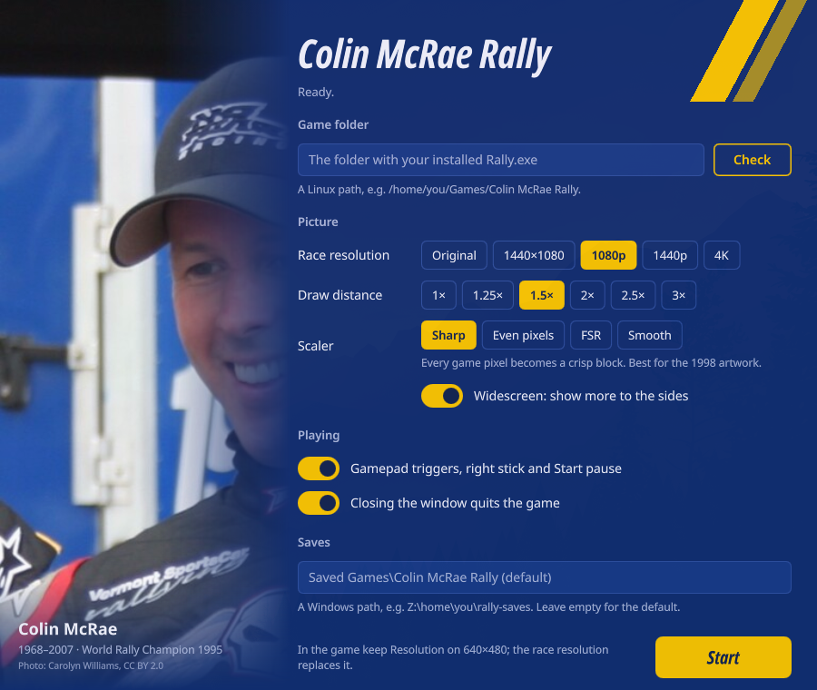

# Colin McRae Rally — play it today

> **Work in progress.** It plays well under Linux (Wine and Proton), but it
> still needs more testing and bug fixes, and it hasn't been tried on native
> Windows yet. Help is very welcome, especially from **Windows** players:
> try it and [report what happens](https://github.com/akitaonrails/rea-colin-mcrae/issues),
> or send a pull request.

Play your own copy of the 1998 PC game **Colin McRae Rally** on a modern
computer: Windows 10/11, or Linux through Steam (Proton) or Wine.

You point the launcher at your installed game and it does the rest. No game
patches, no compatibility settings, no registry edits. Your game folder is
never changed: the launcher works on its own private copy.



## What it adds to the original game

**Runs on today's computers**

- Starts on modern Windows and on Linux; the 1998 game alone stops at its
  CD check, its Windows version check and its old graphics modes.
- No CD needed: the game runs from its installed files.
- Closing the window (or Alt+F4) quits the game; the original ignored it.

**Gamepads**

- Accelerate and brake with the triggers or the right stick, not only the
  left stick.
- Start pauses the race.
- Your controller choice no longer falls back to the keyboard by itself, and
  saves broken by that bug (car turning in circles) are repaired.

**Picture** (all optional)

- Races at higher resolutions, up to 4K (the original stops at 800×600).
- The HUD (speedometer, timer, pause menu) scales with the resolution and
  sits in the corners of wide screens.
- 16:9 widescreen that shows more to the sides instead of stretching.
- A longer view distance, up to 3× further down the stage.

**Comfort**

- Your saves live in a folder you choose, outside the game.
- Your game folder is never modified.
- One settings file with comments, and an optional Linux launcher window.

This project contains **no game files**. You need your own copy of the game.

## 1. The game you need

**Colin McRae Rally for Windows PC, the original 1998 CD-ROM release by
Codemasters, installed and updated to version 1.5.**

- Install it from your CD with the **full install** option (the launcher
  can't read data that was left on the CD).
- Apply the official Codemasters **v1.5 update** if your copy isn't updated
  yet. The installed folder contains `Rally.exe` next to the folders `Game`,
  `New_Fe` and `ini`.
- Already have an installed copy from an older PC, or a backup of the game
  folder? That works too: the launcher only needs that folder.

The launcher checks `Rally.exe` and tells you if it doesn't recognise your
version. Recognised today:

| `Rally.exe` | Version |
| --- | --- |
| SHA-256 `0eb6ea96…5982a` | Official European v1.5 |
| SHA-256 `46500c8e…c0bb` | European v1.5 from a community fan pack |

If yours isn't recognised, the launcher shows its SHA-256. Please
[open an issue](https://github.com/akitaonrails/rea-colin-mcrae/issues) with
that number and where your copy comes from (US release, v1.0, another
language…), and support can be added.

Not supported: the PlayStation version, *Colin McRae Rally 2.0* and later
games.

## 2. Download

Get the latest `CMRLauncher-….zip` from the
[Releases page](https://github.com/akitaonrails/rea-colin-mcrae/releases) and
unpack it anywhere, for example into your game folder. It contains:

- `CMRLauncher.exe` — the launcher
- `cmrhooks.dll` — needed for the HUD at high resolutions; keep it next to the launcher
- `linux/` — the Linux helper and desktop launcher

## 3. Play on Windows

1. Unpack the zip into your game folder (next to `Rally.exe`).
2. Double-click `CMRLauncher.exe`.

That's it: the first start takes a few seconds while the launcher makes its
private copy of the game. If you unpacked the zip somewhere else, start it once
from a command prompt with your game folder:

```text
CMRLauncher.exe --game "C:\Games\Colin McRae Rally"
```

The folder is remembered, so from then on a double-click is enough.

> Windows support is new: the launcher has so far been tested under Wine and
> Proton. If something goes wrong on Windows, please open an issue with your
> `launcher.log` (see [Where things are](#where-things-are)).

## 4. Play on Linux

### With Steam (easiest)

1. Unpack the zip, for example into `~/Games/cmr-launcher`.
2. In Steam: **Games → Add a Non-Steam Game to My Library… → Browse** and pick
   `CMRLauncher.exe`.
3. Right-click it in your library → **Properties → Compatibility** → tick
   **Force the use of a specific Steam Play compatibility tool** and choose
   **GE-Proton** (tested with GE-Proton 11; Proton Experimental should work
   too).
4. In **Properties → General → Launch options**, tell it where your game is
   (Linux paths are written with `Z:` in front):

   ```text
   %command% --game "Z:/home/you/Games/Colin McRae Rally"
   ```

5. Press **Play**. The folder is remembered after the first start.

### With Wine and gamescope

If you have Wine and [gamescope](https://github.com/ValveSoftware/gamescope)
installed, the `linux/cmr-play` script runs the game in its own correctly
sized screen:

```sh
cd ~/Games/cmr-launcher
# once: tell the launcher where your game is
WINEPREFIX=~/.local/share/cmr-launcher/prefix wine CMRLauncher.exe --game "Z:/home/you/Games/Colin McRae Rally"
# every time
linux/cmr-play
```

On desktops with [Quickshell](https://quickshell.org) you can use the
launcher shown above instead (`qs -p linux/quickshell-launcher`): pick your
game folder, press **Check**, choose your options and press **Start**. See
[linux/README.md](linux/README.md).

## 5. Settings

Everything is optional; the defaults give you the original game, with
working gamepads and a window that closes properly.

Settings live in a text file, `launcher.cfg`, created with comments the
first time the launcher runs (see [Where things are](#where-things-are)).
Open it in any text editor; lines starting with `#` are switched off.

| Setting | What it does | Default |
| --- | --- | --- |
| `resolution = 1920x1080` | Races at this resolution, up to `3840x2160`. Leave the game's own **Resolution** option (in its graphics settings) on 640×480: that's the choice this replaces. | the game's own (up to 800×600) |
| `widescreen = true` | On a 16:9 screen, shows more to the sides instead of stretching the picture. | off |
| `draw_distance = 1.5` | Sees further down the stage, from `1.0` to `3.0`. Longer distances can flicker far away and cost speed. | off |
| `gamepad_axes = true` | Triggers and right stick work as accelerate/brake; Start pauses. | on |
| `close_quits = true` | Closing the window (Alt+F4) quits the game. | on |
| `saves = D:\Rally saves` | Where your saves are kept. | `Saved Games\Colin McRae Rally` in your user folder |
| `language = FRENCH` | Game language on first setup: ENGLISH, FRENCH, GERMAN, SPANISH or ITALIAN. | ENGLISH |
| `game = …` | Your game folder (filled in by `--game`). | — |

Every setting can also be given on the command line for one run, for
example in Steam's launch options:

```text
CMRLauncher.exe --resolution 1920x1080 --widescreen on --draw-distance 1.5
CMRLauncher.exe --resolution original          # back to the game's own sizes
CMRLauncher.exe --check --game "D:\Games\Colin McRae Rally"   # is this folder supported?
```

Flags: `--game`, `--saves`, `--runtime`, `--language`, `--resolution`,
`--widescreen on|off`, `--draw-distance`, `--gamepad-axes on|off`,
`--close-quits on|off`. Only `--game` is remembered; the others override
`launcher.cfg` for that run. `CMRLauncher.exe --help` lists them.

### Gamepad

In the game: **Options → Settings → Controller 1**, set **Control method** to
your pad (Joystick 1) and **Controller type** to **Analogue joystick**, then set
steering, acceleration and braking to **Analogue** on the next screen.

Avoid **Run joystick panel** on that screen: it opens an old Windows dialog
that can't appear on most modern setups, and the game then waits for it.

To see what your pad sends to the game, run `CMRLauncher.exe --controllers`
and move every stick and button; the result is written to `launcher.log`.

## Where things are

| What | Where |
| --- | --- |
| Settings | `%LOCALAPPDATA%\CMRLauncher\launcher.cfg` (a `launcher.cfg` next to `CMRLauncher.exe` is used instead, for a portable setup) |
| Log | `%LOCALAPPDATA%\CMRLauncher\launcher.log` |
| The launcher's copy of the game | `%LOCALAPPDATA%\CMRLauncher\Rally` |
| Your saves | `%USERPROFILE%\Saved Games\Colin McRae Rally` (or your `saves` setting) |

Under Wine and Proton these are inside the Wine prefix (for Steam:
`~/.steam/steam/steamapps/compatdata/<id>/pfx/drive_c/users/steamuser/…`).

## Troubleshooting

- **The car doesn't move, or turns in circles.** The controls in your save
  point at a gamepad that isn't there. Plug the pad in, or set Control method
  back to Keyboard in Options → Settings → Controller 1.
- **The game crashes at start on a PC with a portrait (rotated) monitor.** The
  1998 game can't use a portrait main screen. Make a landscape monitor your
  main display, or on Linux use `linux/cmr-play` (gamescope gives the game a
  landscape screen).
- **At high resolutions the menus are small in a corner.** Known: the game's
  menus are drawn at 640×480 and aren't scaled up yet; races are full screen.
- **Steam/Proton: the game crashes right away with an NVIDIA card.** Some
  setups only give 32-bit programs working OpenGL through Proton's WoW64
  mode. Add `PROTON_USE_WOW64=1` in front of `%command%` in the launch
  options.
- **Anything else:** open an issue and attach `launcher.log`.

## Known limitations

- The menus, the intro screens and the results text aren't scaled to high
  resolutions yet.
- Split screen isn't adjusted for widescreen.
- Only the European v1.5 `Rally.exe` is recognised so far.

## For developers

```text
cargo test                                          # host tests
cargo build --release --target i686-pc-windows-gnu  # needs i686-w64-mingw32-gcc;
                                                    # builds CMRLauncher.exe and cmrhooks.dll
```

GitHub Actions builds the Windows package on every push and publishes a
release for tags named `v…`. How it works and what's left:
[docs/THIN_APP_PLAN.md](docs/THIN_APP_PLAN.md) (fix list and status),
[docs/GRAPHICS.md](docs/GRAPHICS.md), [docs/RUNTIME_NOTES.md](docs/RUNTIME_NOTES.md).
Rules for contributors are in [AGENTS.md](AGENTS.md).

The game fixes are applied in memory to the running game, keyed to the exact
`Rally.exe`; nothing is patched on disk.

## Legal

Colin McRae Rally is © Codemasters. This project is not affiliated with or
endorsed by Codemasters or Electronic Arts, contains no game code or assets,
and only runs a copy you own. Our code is MIT or Apache-2.0
([LICENSE-MIT](LICENSE-MIT), [LICENSE-APACHE](LICENSE-APACHE)); bundled
third-party parts and the launcher photo (Carolyn Williams, CC BY 2.0) are
listed in [THIRD_PARTY.md](THIRD_PARTY.md).
